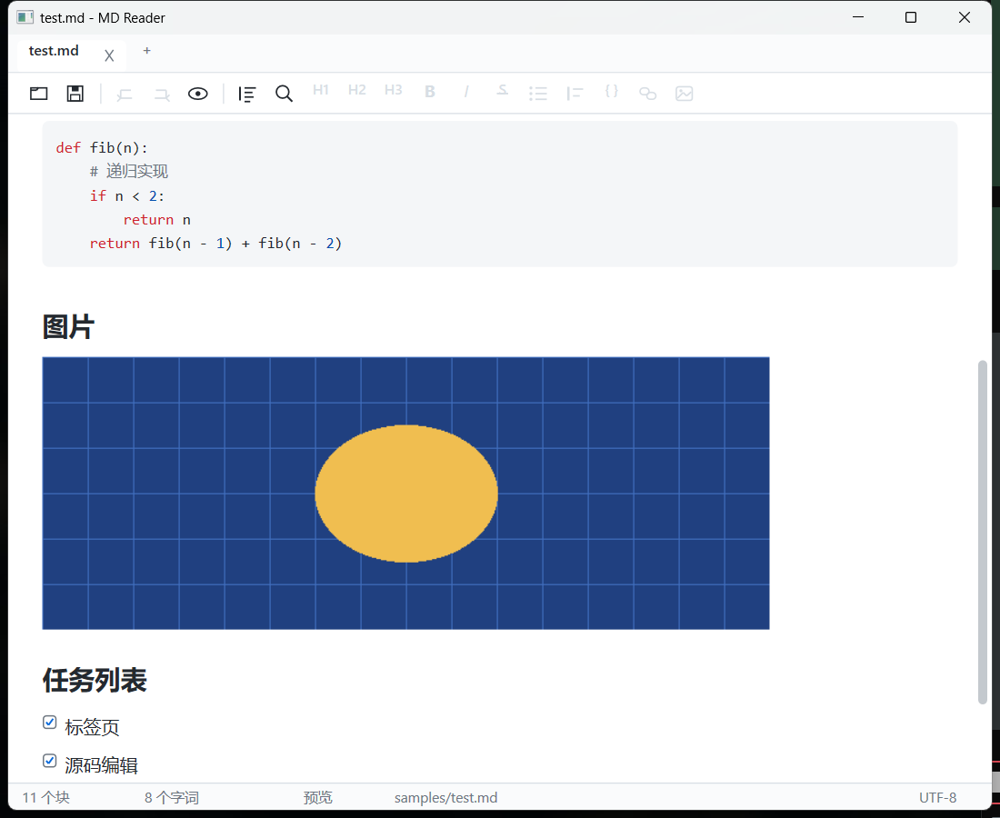
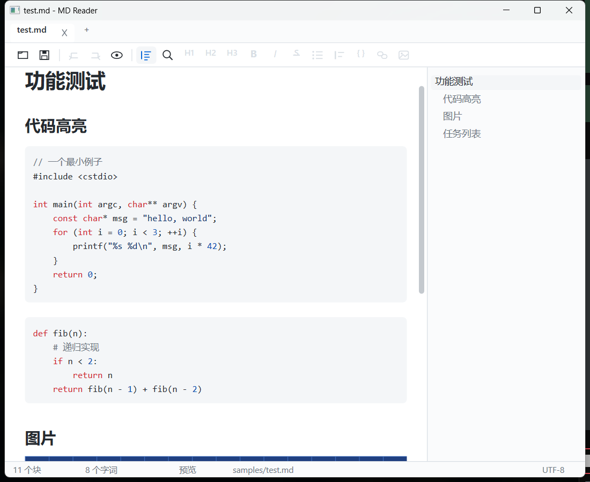

# MD Reader

Windows 上的极简 Markdown 阅读器 / 编辑器。Win32 + Direct2D + DirectWrite + md4c，C++20，无框架。单文件 1.4 MB，静态链接，不依赖 VC 运行库。



界面按记事本的样子排：标签栏 / 图标工具条 / 正文 / 状态栏。

源码模式（可编辑，`Ctrl+E` 切换）：


大纲面板（`Ctrl+J`，点击跳转，滚动自动跟随）：



## 构建

不需要 Visual Studio。装一个 MinGW-w64 并把 `g++`/`gcc`/`windres` 放进 PATH（本机用的是便携版 [w64devkit](https://github.com/skeeto/w64devkit)，解压到 `.tools/w64devkit` 即可，`build.sh` 会自动找），然后：

```sh
sh build.sh
```

产物 `build/mdreader.exe`，约 1.4 MB。用 MSVC 的话 `cmake -B build-msvc -G "Visual Studio 17 2022"`。

## 用法

```
mdreader.exe <文件.md>
mdreader.exe <文件.md> --dark | --light     强制主题
mdreader.exe --register | --unregister     写入/删除文件关联（HKCU）
```

拖放文件、`Ctrl+O` 打开，第二次启动会把路径交给已经运行的窗口（单实例）。

## 快捷键

| 键 | 作用 | 键 | 作用 |
| --- | --- | --- | --- |
| Ctrl+N | 新建标签页 | Ctrl+W | 关闭标签页 |
| Ctrl+O | 打开 | Ctrl+S | 保存 |
| Ctrl+Tab | 下一个标签页 | Ctrl+E | 源码 / 预览切换 |
| Ctrl+J | 大纲 | Ctrl+F | 查找 |
| Ctrl+B | 加粗 | Ctrl+I | 斜体 |
| Ctrl+K | 链接 | Ctrl+Z / Ctrl+Y | 撤销 / 重做 |
| Ctrl+A | 全选 | Ctrl+C / X / V | 复制 / 剪切 / 粘贴 |
| F3 / Shift+F3 | 下一个 / 上一个匹配 | Esc | 关闭查找 |

预览：滚轮、PageUp/PageDown、空格、Home/End、方向键。
源码：方向键、Home/End、Ctrl+←/→ 按词移动、Shift 选中、Shift+滚轮横向滚动。

## 功能

- CommonMark + GFM：标题、列表（有序/无序/嵌套/任务列表）、引用、围栏代码块、表格、分隔线、删除线、行内代码
- 代码块语法高亮（注释 / 字符串 / 数字 / 关键字，C 系、Python、Shell、Markdown 等共用一套词法规则）
- 图片：本地相对路径，WIC 后台线程解码，解码完成自动回流排版
- 标签页：新建 / 切换 / 关闭，脏标记，关闭前提示保存
- 源码编辑：光标、选区（鼠标/Shift）、中文 IME（输入法窗口跟随光标）、撤销（400 ms 内合并）、Ctrl+S 保存
- 工具条：打开、保存、撤销、重做、源码/预览、大纲、查找、H1–H3、B、I、S、列表、引用、行内代码、链接、图片（图标是自绘的，不依赖图标字体和图片资源）
- 大纲面板：层级缩进、当前章节高亮、点击跳转、滚轮独立滚动
- 查找：源码模式按字符定位，预览模式跳到匹配块；显示 `n / 总数`
- 状态栏：行/列、字符数或字词数、模式、路径、编码
- 深浅色跟随系统，自绘滚动条，窗口大小和大纲开关状态持久化

## 实测数据

Windows 11 23H2，2048×1152 @125%：

| 项目 | 数值 |
| --- | --- |
| 二进制体积 | 1,456,640 字节 |
| zip 压缩后 | ~430 KB |
| 窗口可见 | 47–78 ms |
| 首帧内容 | ~100 ms |
| 小文档内存 | ~42 MB 工作集 |
| 单帧绘制（1080×900） | 2–5 ms |
| 源码 | 约 4200 行 |

## 结构

```
src/doc.{h,cpp}        md4c → Block 树（块、行内 run、图片、任务列表）
src/layout.{h,cpp}     Block → Item，视口优先的增量排版
src/graphics.cpp       D2D 设备、画笔、绘制、滚动几何、大纲面板
src/chrome.cpp         标签栏、工具条（自绘图标）、查找栏、状态栏
src/source.cpp         源码视图绘制与光标命中
src/editor.cpp         文本缓冲区、光标/选区、撤销、Markdown 命令
src/images.cpp         WIC 解码线程、位图缓存、占位
src/highlight.cpp      代码块词法着色
src/main.cpp           窗口过程、输入、标签页、查找、设置、文件关联
tools/bench.c          启动时间/内存测量
```

排版层不碰窗口状态，`layoutStep(app, untilY, budgetMs)` 只依赖视口尺寸和文档，换渲染后端时这部分可以保留。

## 还没做 / 已知问题

- 表格单元格内的行内样式（粗体、链接）会丢，只保留纯文本
- 每个文件的滚动位置没有持久化（只存窗口尺寸和大纲开关）
- 链接不能点击跳转（只着色）
- 源码视图没有软换行和语法高亮，横向滚动只支持 Shift+滚轮
- 撤销按整篇快照实现，超大文档（>5 MB）内存开销偏高
- IME 组字窗口由系统绘制，没有在行内画候选高亮
