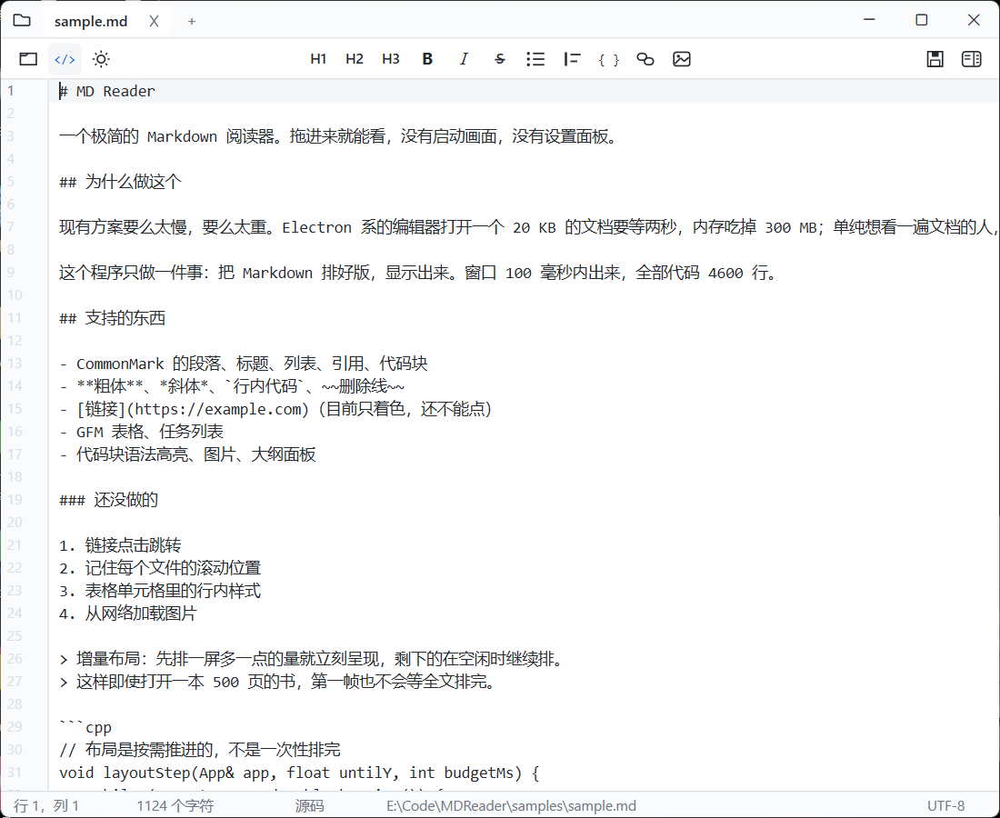

# MD Reader

Windows 上的极简 Markdown 阅读器 / 编辑器。Win32 + Direct2D + DirectWrite + md4c，C++20，无框架。单文件 1.4 MB，静态链接，不依赖 VC 运行库。


界面照记事本的样子排：标题栏里直接放"程序图标 + 标签页 + 新建 + 窗口按钮"，没有标题文字；下面是图标工具条、正文、状态栏。标题栏是自绘的（无边框窗口），窗口圆角取 Windows 11 的系统圆角。

源码模式（可编辑，`Ctrl+E`）：



大纲面板（`Ctrl+J`）：


## 功能

**阅读**

- CommonMark + GFM：标题、列表（有序 / 无序 / 嵌套 / 任务列表复选框）、引用、围栏代码块、表格、分隔线、删除线、行内代码
- 代码块语法高亮：注释、字符串、数字、关键字，C 系 / Python / Shell / Markdown 共用一套词法
- 图片：本地相对路径，WIC 后台线程解码，解码完成自动回流排版
- 视口优先的增量排版：先排一屏就出帧，其余在空闲时补
- 大纲面板：层级缩进、当前章节跟随高亮、点击跳转、滚轮独立滚动
- 查找：`Ctrl+F`，源码模式按字符定位，预览模式跳到匹配块

**编辑**

- 源码模式：光标、选区（鼠标 / Shift）、中文 IME（输入法窗口跟随光标）、撤销（400 ms 内合并）、`Ctrl+S` 保存
- 工具条 Markdown 命令：H1–H3、加粗、斜体、删除线、列表、引用、行内代码、链接、图片，作用于选区或当前行
- 粘贴图片：`Ctrl+V`，支持资源管理器复制的图片文件、PNG 数据流、裸位图；存到文档同级 `attachment/`，插入 ``

**外壳**

- 标签页：新建 / 切换 / 关闭、脏标记、关闭前提示保存
- 无边框窗口：边缘拖拽缩放、标题栏空白拖动、双击最大化、系统圆角
- 深浅色跟随系统，工具条最左侧一键切换
- 单实例：第二次启动把路径交给已运行的窗口（`WM_COPYDATA`）
- `--register` / `--unregister` 写入 / 删除 HKCU 文件关联
- 窗口尺寸和大纲开关状态持久化

## 快捷键

| 键 | 作用 | 键 | 作用 |
| --- | --- | --- | --- |
| Ctrl+N | 新建标签页 | Ctrl+W | 关闭标签页 |
| Ctrl+O | 打开 | Ctrl+S | 保存 |
| Ctrl+Tab | 下一个标签页 | Ctrl+E | 源码 / 预览 |
| Ctrl+J | 大纲 | Ctrl+F | 查找 |
| Ctrl+B | 加粗 | Ctrl+I | 斜体 |
| Ctrl+K | 链接 | Ctrl+Z / Ctrl+Y | 撤销 / 重做 |
| Ctrl+A | 全选 | Ctrl+C / X / V | 复制 / 剪切 / 粘贴 |
| F3 / Shift+F3 | 下一个 / 上一个匹配 | Esc | 关闭查找 |

预览只读：滚轮、PageUp/PageDown、空格、Home/End、方向键。
源码：方向键、Home/End、Ctrl+←/→ 按词移动、Shift 选中、Tab 缩进、Shift+滚轮横向滚动。

## 下载与安装

从 [Releases](https://github.com/cjbbt001/mdReader/releases) 下载 `MDReader-win64.zip`，解压即用（单个 exe，不写注册表）。

想要桌面快捷方式：把 exe 放到任意目录，右键 → 发送到 → 桌面快捷方式。

```
mdreader.exe <文件.md>
mdreader.exe <文件.md> --dark | --light      强制主题
mdreader.exe --register | --unregister      写入 / 删除 .md 文件关联
```

## 构建

不需要 Visual Studio。装一个 MinGW-w64，把 `g++` / `gcc` / `windres` 放进 PATH（本机用便携版 [w64devkit](https://github.com/skeeto/w64devkit)，解压到 `.tools/w64devkit` 即可，`build.sh` 会自动找），然后：

```sh
sh build.sh          # -> build/mdreader.exe
```

MSVC：`cmake -B build-msvc -G "Visual Studio 17 2022" && cmake --build build-msvc --config Release`。

## 实测

Windows 11 23H2，2048×1152 @125%：

| 项目 | 数值 |
| --- | --- |
| 二进制 | 1,486,336 字节（zip 约 596 KB） |
| 窗口可见 | 47–78 ms |
| 首帧内容 | 约 100 ms |
| 空窗口内存 | 42 MB 工作集 |
| 单帧绘制（1080×900） | 2–5 ms |
| 源码 | 约 4,650 行 |

## 设计取舍

**渲染用软件后端**（`D2D1_RENDER_TARGET_TYPE_SOFTWARE`）。硬件渲染目标要 127 ms 建一次 D3D 设备，软件只要 8 ms，单帧 2–5 ms，纯文本完全够用。

**没有 `CoInitializeEx` 之外的 COM 初始化**，D2D / DirectWrite / 文件对话框都不强制要求，只在打开对话框和 WIC 解码时按需初始化。

**排版与绘制分离**：`layoutStep(app, untilY, budgetMs)` 只依赖视口尺寸和文档，不碰窗口状态。

**内存的大头是 Direct2D / DirectWrite 本身**（空窗口 42 MB）。要压到记事本的个位数只能换成 GDI 绘制 + DirectWrite 排版，那是另一个工程量。

## 目录

```
src/doc.{h,cpp}        md4c → Block 树（块、行内 run、图片、任务列表）
src/layout.{h,cpp}     Block → Item，视口优先的增量排版
src/graphics.cpp       D2D 设备、画笔、绘制、滚动几何、大纲面板
src/chrome.cpp         标签栏（自绘标题栏）、工具条图标、查找栏、状态栏
src/source.cpp         源码视图绘制与光标命中
src/editor.cpp         文本缓冲区、光标/选区、撤销、Markdown 命令
src/images.cpp         WIC 解码线程、位图缓存、剪贴板位图落盘
src/highlight.cpp      代码块词法着色
src/main.cpp           窗口过程、输入、标签页、查找、设置、文件关联
third_party/md4c/      MIT，Markdown 解析 v0.5.2
tools/bench.c          启动时间 / 内存测量
```

## 已知限制

- 表格单元格内的行内样式（粗体、链接）会丢，只留纯文本
- 每个文件的滚动位置没有持久化（只存窗口尺寸和大纲开关）
- 链接不能点击跳转（只着色）
- 源码视图没有软换行和语法高亮，横向滚动只支持 Shift+滚轮
- 撤销按整篇快照实现，超大文档（>5 MB）内存开销偏高
- 图片只支持本地文件，不下载 http(s)
